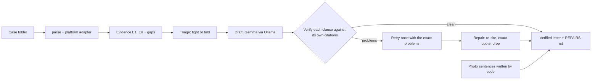

# Dispute Defender

A local AI that drafts a seller's reply to a marketplace dispute, where **every clause must cite numbered evidence**.

A buyer says the item never arrived, was not as described, or arrived damaged. The seller has a short deadline, the
facts are scattered across an order record, tracking, a message thread and a policy, and the amount is often too small
to feel worth the effort. Dispute Defender builds the evidence list, drafts the letter with a local Gemma model, then
checks each clause against only the evidence it cites. Code repairs what it can **without adding a word** and drops
the rest.

- Model: **Gemma 3 4B**, open-weight, running locally through Ollama. Customer data stays on the seller's machine.
- Code: Python 3.10+, **standard library only** (nothing to install).
- Built for the DEV Hacktoberfest Open-Source AI Challenge, Week 2 ("Side Hustle"). The project and this repository
  were started and completed inside the challenge window. Commits after the submission deadline, if any, are listed
  here: none so far.
- All cases are **synthetic**. The Etsy policy and checklist are **placeholders**. See [Known limits](#known-limits).

## What the output looks like

Synthetic case 002 (a $29 towel set), from a real run:

    Order 9814174 for Linen kitchen towel set ($29.00) was placed on 2026-01-13. [E2]
    The carrier shows the package delivered on 2026-01-18. [E4]
    On 2026-01-23, the buyer wrote: "The box was crushed and the item inside is broken." [E5]

Every line ends in a citation. A line the verifier cannot support is repaired or removed, and each change is listed
under `REPAIRS` in the output.

## Results

"First draft clean" means the verifier found nothing wrong in the model's first attempt. It is a text check, not a
judge of meaning. Machine for all rows below: one ASUS laptop (Ollama put about 46% of the 3.5 GB model on the GPU).

### Same machine, same 30 generated cases (26 scored; 4 were fold verdicts and were not drafted)

| Setup | Runs scored | First draft clean | Needed repair | Content dropped | Attempts | Seconds/case |
|---|---|---|---|---|---|---|
| Full prompt, 1 run per case | 26 | 92% (24 of 26) | 8% | 4% | 1.04 | 25.2 |
| Full prompt, 3 runs per case | 77 (1 Ollama HTTP 500 error) | 94% (72 of 77) | 6% | 3% | 1.03 | 25.5 |
| Minimal prompt, no fine-tune | 26 | 0% (0 of 26) | 69% | 50% | 2.0 | 42.1 |

Files: `results/asus_full_fresh30.json`, `results/asus_full_fresh30_x3.json`, `results/asus_short_fresh30.json`.
The three-run result is not three independent confirmations: three of its five non-clean runs are the same case
(case_016). Put differently, 23 of 26 cases were clean in every run.

The minimal prompt (`--prompt-style short`) is designed for a fine-tuned model. It was run here on the untuned base
model, as a test of what happens when the rules are left out.

### Earlier measurements (different builds, cases and machines; not directly comparable with the table above)

| Run | Cases | First draft clean | Notes |
|---|---|---|---|
| Model writes photo sentences, first prompt (`results/baseline_prompt_v1.json`) | 15 runs on 3 hand-built cases | 40% | photo claims in 7 runs; 53.3 s/case |
| Stricter prompt (`results/prompt_v2.json`) | same 15 runs | 60% | photo claims fell to 1, but evidence ids in prose (5) and uncited lines (5) appeared; 67.4 s/case |
| Full prompt on 6 cases, ASUS (`results/asus_full6.json`) | 6 cases, 1 run each | 67% (4 of 6) | 2 runs repaired, both by dropping content; 26.4 s/case |
| Minimal prompt on the same 6 cases, ASUS | 6 cases, 1 run each | 17% (1 of 6) | about 40 s/case |

Other earlier runs are described in the write-up: letting code write the photo sentences gave 100% clean on the 15
runs of the cases the prompt was tuned on (a tuned-on result, not a held-out one), 95% on 20 unseen generated cases,
and 67% on 12 scored runs of a harder generator on a CPU-only laptop. [Add result file names for these if saved.]

## Quick start (Windows PowerShell or Git Bash; Python 3.10+; no packages to install)

    cd <folder that contains dd, cases and tests>
    python -m unittest discover -s tests                       # 163 tests, all offline
    python -m dd batch cases --today 2026-03-12                # sample cases, offline template drafter
    python -m dd run cases/case_005_nad_with_listing --today 2026-03-12

With a local Gemma (install Ollama from ollama.com and keep it running):

    ollama pull gemma3:4b
    python -m dd doctor
    python -m dd run cases/case_005_nad_with_listing --backend ollama --today 2026-03-12 --exclude E7,E8
    python -m dd run cases/case_005_nad_with_listing --backend ollama --exclude E7,E8 --show-drafts

`--exclude E7,E8` leaves evidence out of the letter (for example the seller's own refund offer, which can weaken the
seller's position; the tool warns about it). `--show-drafts` prints the raw model draft next to the verified letter.

`python -m dd --version` prints the build (this one: `dd 2026.10.16-a`). If a command is invalid or the test count is
lower than stated, an older copy is installed.

**"No module named dd"?** `python -m dd` only works from the folder that contains `dd`. From the folder above it, use
`python dispute-defender run cases/...`, or from anywhere `python <path>/dispute-defender/run.py run cases/...`.

## Reproduce the numbers

`fresh_cases/` is included, so you do not need to regenerate it. Use the same build, and note the generator changes
with the version (the same seed produces different cases after an upgrade).

    python -m dd generate fresh_cases --count 30 --seed 20261016        # only if you want to regenerate
    python -m dd eval fresh_cases --backend ollama --repeat 1 --auto-exclude --out results/my_full.json
    python -m dd eval fresh_cases --backend ollama --repeat 1 --auto-exclude --prompt-style short --out results/my_short.json
    python -m dd report results/my_full.json

`report` lists every flagged clause and what the repair did. Expect run-to-run variation: it is a 4B model. A full run
takes roughly 11 minutes for the full prompt and 18 minutes for the minimal prompt on the ASUS used here. Results are
saved after every run, and Ctrl+C stops cleanly.

## Failure gallery (real flagged clauses)

**A true fact cited to the wrong evidence item, repaired without adding a word** (full prompt, case_016, all 3 runs)

    flagged: date not in cited evidence: April 22
             Tracking shows it was delivered on April 22 [E6].
    repair:  completed a citation: added E7 (the fact is in that evidence, not the one cited)

**The same kind of mistake, dropped instead** (full prompt, case_030, run 1)

    flagged: number or date not in cited evidence: 2026-06-06
             The buyer opened a dispute on 2026-06-06 [E6].
    repair:  dropped

The date appears in two evidence items (the case notice and a message). The repair adds a citation only when exactly
one other item contains the fact; with two it does not guess which one was meant, so the sentence is dropped. This is
a deliberate fail-closed choice, and it can lose a sentence that was true.

**A paraphrase that is fair to a human but not to a word check** (6-case full-prompt run, case_006)

    flagged: strong claim word not in cited evidence: received
             The buyer says I have not received my order [E4].
    repair:  dropped

**What the model writes when the rules are removed** (minimal prompt, case_001)

    flagged: strong claim word not in cited evidence: never
             Thank you for reaching out regarding order 1054145, ... I understand your concern that the
             package never arrived, despite the tracking
    flagged: text after the last citation has no evidence
             ... I want to assure you I'm committed to resolving this issue.

On the minimal prompt the first-draft problems, in runs affected, were: uncited text 15, overclaim word 14, number or
date 9, uncited line 9, empty letter 8, name 3, quote 3, date 2.

## Architecture

The model is the only non-deterministic part. Everything before it builds the facts it may use, and everything after
it is deterministic code that checks, repairs or removes what the model wrote.

| Module | Job |
|---|---|
| `parse.py`, `models.py` | read a case folder (any Windows encoding) into typed objects |
| `adapters/etsy.py` | platform rules: dispute types, response window and checklist (placeholders) |
| `evidence.py` | number the evidence (E1..En) and find gaps with how to fill them |
| `triage.py` | explainable fight-or-fold score from which evidence exists, times the amount |
| `draft.py` | prompts (full and short), the Ollama backend (streaming, stall detection) and the offline mock drafter |
| `verify.py` | clause-level verifier and the repair step (the core of the project) |
| `pipeline.py` | runs the steps above for one case and returns the letter, REPAIRS and warnings |
| `evalrun.py` | `eval` and `report`: first-draft clean rate, repair rate, mistake types, speed |
| `generate.py`, `harvest.py` | synthetic case generator; collects verified letters as training pairs |
| `doctor.py`, `cli.py`, `api.py` | local-model health check, command line, thin JSON API |

Design choices that follow from this:

- **Fail closed.** If a clause cannot be supported by the evidence it cites, it is repaired only when the fix is
  unambiguous. Otherwise it is dropped and listed.
- **The model never sees photos.** Photo evidence is a file name only, so code writes those sentences.
- **Local by default.** The Ollama address is this machine; a remote address produces a warning on every result.

## What happens to a case

    load -> classify -> evidence (E1..En) -> gaps -> triage (fight or fold) -> draft -> verify -> retry -> repair

1. **Evidence.** Notice, order, tracking, delivery, photos (file names only), messages, listing text and policy become
   numbered items. Missing items are listed as gaps with how to get them.
2. **Triage.** An explainable score from which evidence exists, times the amount, says fight or fold. It is a
   heuristic, not a calibrated probability.
3. **Draft.** The model gets the evidence, the central question, the key evidence to lead with, and a style example.
   Photo sentences are written by code: the model never sees photo evidence (`--photos model` turns that off).
4. **Verify.** Each clause (text ending in a citation) is checked against only the evidence it cites: quotes, numbers,
   dates, ids, names, strong-claim words, unsupported apologies and admissions, and photos may only be mentioned by
   file name.
5. **Retry.** One retry that includes the previous draft and the exact problems. If code can repair the draft without
   dropping anything, the retry is skipped because it only costs time.
6. **Repair.** If it still fails, code keeps every clause that verifies and fixes what it can without inventing
   anything: a fact cited to the wrong item (the right citation is added when exactly one item has it), a near-miss
   quote (replaced by the exact text), emphasis words the evidence does not use (removed), a bad photo clause
   (rewritten). Everything else that fails is dropped. If nothing usable remains it uses an evidence-only template.
   The result is re-verified, and repair never adds a word that is in neither the draft nor the evidence. Every change
   is listed
